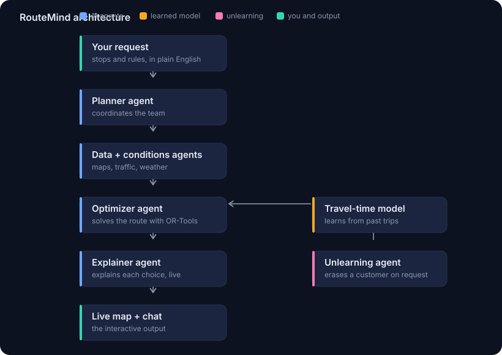

# RouteMind

**An AI-assisted route planner where a small crew of agents plans the smartest delivery run, a real solver does the math, and the map redraws as you change the plan in plain English.**

You describe your stops and rules in plain English, Google OR-Tools does the optimization, and a crew of AI agents validates the plan, predicts conflicts, auto-repairs an impossible run, and explains every choice — live.

> 🔗 **Live demo:** _<!-- paste your Vercel URL here once deployed, e.g. https://routemind.vercel.app -->_
>
> 🧑‍💻 **Author:** Poornesh Muppalam · 👨‍🏫 **Professor:** Prashant Khanduri



---

## What it is

RouteMind plans a food bank's daily delivery van run. A dispatcher adds community delivery sites (by address search or map click), sets each site's **serving window** and **on-site drop time**, chooses when the van departs, and asks the system to build the shortest run that still reaches every site inside its window. The result is drawn on a live map as a turn-by-turn route with an estimated arrival (ETA) at each stop.

It's built for the people who plan routes by hand today — a local courier, a florist doing morning drops, a repair tech with a day of house calls, a food bank running a van. They either pay for heavy dispatch software or plan on Google Maps by memory. RouteMind gives them big-company routing without the big-company cost.

**The deliverable is a run sheet:** hit *Optimize with agents* and RouteMind returns the driver's actual work order — which site to visit in what order, the ETA at each one, the total distance and drive time, and which serving windows forced the order — with the agents narrating each step as they build it.

## Why it's built this way

The interesting design decision is **what does the thinking**. Letting a language model do routing arithmetic would be slow and unreliable, so it doesn't:

- **A constraint solver (Google OR-Tools)** computes the actual visiting order, respecting time windows, drop times, the departure time, and optional ordering pins. Road distances and drive times come from a real routing service (OSRM).
- **A crew of AI agents (LangGraph)** wraps the solver with real analysis: validating inputs, predicting conflicts before solving, running the solver, auto-repairing an infeasible run, and advising the dispatcher — in plain English.
- **A natural-language chat** lets you edit the run or ask questions in plain English; an LLM interprets the request (with a rule-based fallback), and the deterministic edit is applied and re-solved by the backend.

So RouteMind is an honest hybrid: **agents for language, a solver for math, and a live interface that shows the work.** It runs fully **free and offline-capable** — without any API key the chat uses a rule-based parser and the agents use computed text; with a free LLM key (Google Gemini by default) the same flows gain natural-language quality.

## What you can do

- See a set of stops on a live Google map the moment the app loads.
- Click anywhere on the map (on land) or search an address to add a stop.
- Set a serving window on a stop (e.g. the shelter must be reached between 9 and 11 am).
- Hit **Solver only** and watch the shortest valid order get drawn on the map.
- Hit **Optimize with agents** and watch the five-agent crew work step by step in a live activity panel, then draw the optimized route with a plain-English explanation.
- Type a change in plain English and watch the run re-plan, with RouteMind explaining what changed and what it cost.

## The agent crew

LangGraph wires five agents into a pipeline; only the optimizer touches the real math.

| Agent | Job |
| --- | --- |
| **Validator** | Checks the sites — out-of-area, duplicate, or outlier pins, implausible drop times. |
| **Feasibility** | Predicts window conflicts *before* solving. |
| **Optimizer** | Calls the OR-Tools solver — the one agent that does real math. |
| **Diagnostician** | Reacts: on failure runs a minimal-impact fix ladder (shift departure → widen a window → drop a site); on success flags a disproportionately costly site. |
| **Advisor** | Synthesizes it all into one recommendation for the dispatcher. |

The language work runs on a fast, provider-agnostic LLM (**Google Gemini** by default; Groq, Ollama, or Claude also work). Steps stream to the browser over Server-Sent Events. Without a key, the agents fall back to deterministic text so the app still runs.

## The chat — edit the run in plain English

Type a change in the **Change the run** box and RouteMind interprets it, re-plans, and tells you what it cost:

- `drop the senior center` — remove a site.
- `move the shelter to 8 to 9 am` — set or change a serving window.
- `the shelter needs 30 minutes to unload` — set a site's drop time.
- `put Seven Trees last` / `put the shelter first` — pin a site's position (a hard ordering constraint for OR-Tools).
- `don't return to the food bank` — one-way run.
- `re-optimize` — just re-run.

Each reply says what changed and the distance / drive-time delta versus the previous run. If a change can't be met (e.g. forcing a windowed site out of its window), RouteMind says so and leaves the run unchanged. The language model only decides *what* to change; OR-Tools does the routing.

## Tech stack

- **Frontend:** Next.js 14, TypeScript, React, and **Google Maps** — real street-by-street routing (Directions API), address search (Places + Geocoding), and land-only clicks (reverse geocoding).
- **Backend:** FastAPI (Python) with **Google OR-Tools** for optimization, **LangGraph** for the agent graph, a provider-agnostic LLM adapter (Gemini / Groq / Ollama / Claude) for the agents and chat, and **OSRM** for real road distances.
- **Deploy:** Render (backend) + Vercel (frontend).

## Run it locally

You run two small programs — the Python backend and the Next.js frontend — each in its own terminal.

### 1. Backend

```bash
cd backend
python -m venv .venv
source .venv/bin/activate          # Windows: .venv\Scripts\activate
pip install -r requirements.txt
cp .env.example .env               # optional: add a free LLM key for natural-language agents
uvicorn app:app --reload --port 8000 --env-file .env
```

The API is live at http://127.0.0.1:8000 (open it for a health check).

### 2. Frontend

In a second terminal:

```bash
cd frontend
cp .env.local.example .env.local
npm install
npm run dev
```

Add your `NEXT_PUBLIC_GOOGLE_MAPS_API_KEY` to `.env.local` (see [Google Maps key](#google-maps-key)) so the map renders, then open http://localhost:3000.

## Deploy

RouteMind is two programs, so it deploys as two free-tier services connected to this repo: the FastAPI **backend on Render**, the Next.js **frontend on Vercel**. Deploy the backend first so you have its URL for the frontend.

### 1. Backend on Render

1. In [Render](https://render.com), create a new **Blueprint** and point it at this repo — Render reads [`render.yaml`](render.yaml) and provisions the `routemind-api` web service automatically (root `backend/`, `uvicorn app:app --host 0.0.0.0 --port $PORT`).
2. (Optional) In the service's **Environment**, add an LLM key (`LLM_BASE_URL` + `LLM_API_KEY` + `LLM_MODEL`) to run the agents/chat on a real model instead of the template fallback.
3. Note the service URL, e.g. `https://routemind-api.onrender.com`.

> The free tier sleeps after inactivity, so the first request after idle takes ~30–60s to wake.

### 2. Frontend on Vercel

1. In [Vercel](https://vercel.com), **Import** this GitHub repo.
2. Set **Root Directory** to `frontend`.
3. Add two environment variables *before* deploying (`NEXT_PUBLIC_*` vars are baked in at build time):
   - **`NEXT_PUBLIC_BACKEND_URL`** = your Render URL from step 1.
   - **`NEXT_PUBLIC_GOOGLE_MAPS_API_KEY`** = your Google Maps key (see below).
4. Deploy. Vercel auto-detects Next.js; open the resulting URL — that's your live demo link. Paste it at the top of this README.

CORS is already open on the backend, so the Vercel frontend can call the Render backend out of the box.

### Google Maps key

The map uses Google Maps. Create an API key in **Google Cloud** with **billing enabled** and enable: **Maps JavaScript API**, **Directions API**, **Places API**, **Geocoding API**. Put it in `NEXT_PUBLIC_GOOGLE_MAPS_API_KEY` (locally in `frontend/.env.local`, and in Vercel). **Restrict the key** to your Vercel domain and `localhost` — it ships to the browser, so an unrestricted key can be abused.

## Project structure

```
routemind/
├── backend/
│   ├── app.py            FastAPI app — /optimize, agent, and chat endpoints
│   ├── solver.py         OR-Tools solver + real road distances (OSRM)
│   ├── agents.py         the five-agent LangGraph crew + LLM adapter
│   ├── chat.py           the plain-English chat: edits + questions
│   └── requirements.txt
├── frontend/
│   └── app/
│       ├── page.tsx      main screen, state, and the control panel
│       ├── globals.css   the dispatch-console styling
│       ├── components/MapView.tsx   Google Maps: pins, route line, vehicle
│       └── lib/          api.ts (backend client) + types.ts
├── docs/architecture.svg
├── render.yaml           backend deploy blueprint (Render)
└── TECHNICAL_REPORT.md   full technical write-up
```

## Notes on realism

RouteMind uses **real road distances and drive times** from a routing service (OSRM), not straight-line estimates — so distances, drive times, and ETAs reflect the actual road network. It falls back to a straight-line estimate at a fixed average speed only if the routing service is unreachable, and every result reports which source it used. The remaining step toward full realism is **live traffic**: wiring a traffic-aware provider (e.g. a keyed Distance Matrix API with `departure_time=now`) is a drop-in change behind the same solver interface.

## License

MIT. See [LICENSE](LICENSE).
